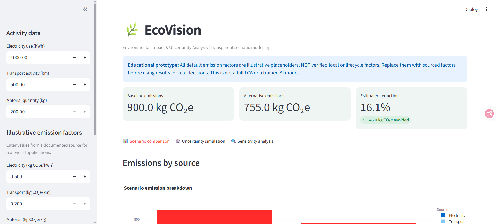
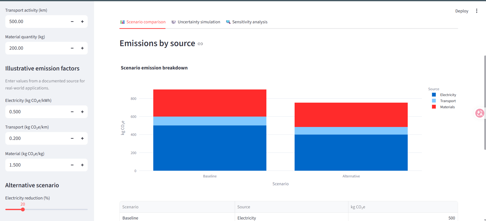
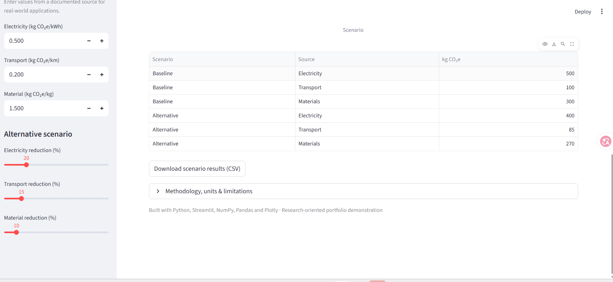
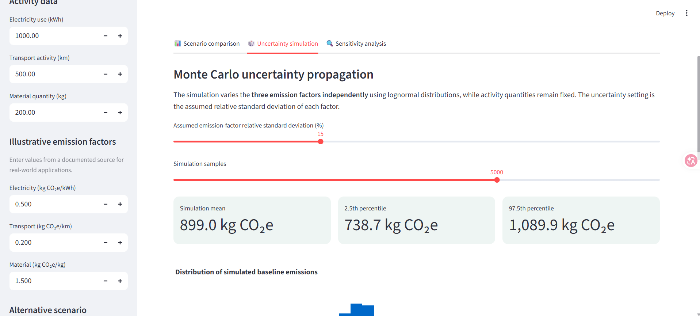
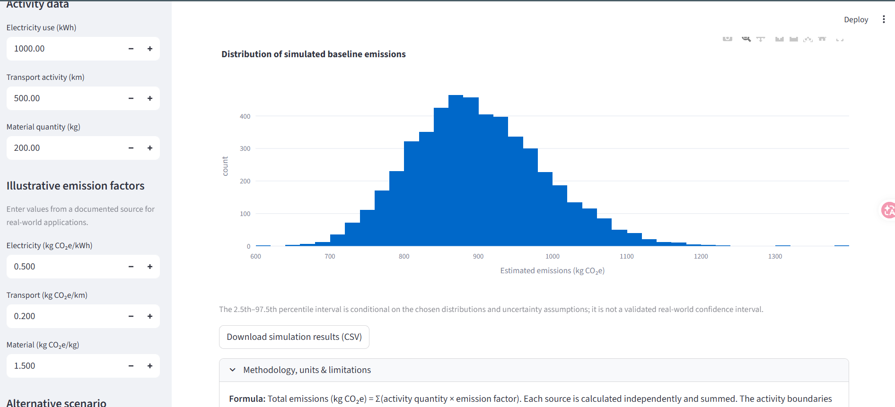
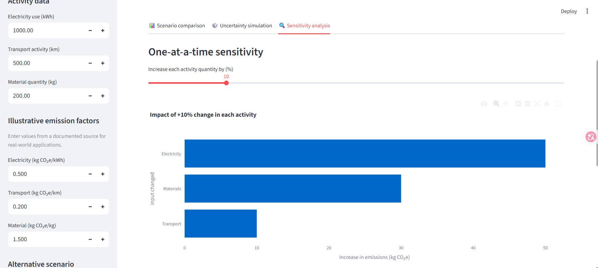
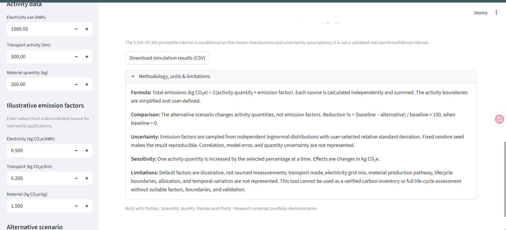

# EcoVision 🌿

**Environmental Impact & Uncertainty Analysis**

A Python + Streamlit interactive scientific-computing dashboard for exploring simplified greenhouse-gas emission scenarios, Monte Carlo uncertainty, and one-at-a-time sensitivity analysis.

> **Important scope note:** This is an educational, research-oriented prototype. Default emission factors are **illustrative placeholders**, not validated regional or lifecycle factors. EcoVision is **not a trained AI model, verified emissions inventory, or complete life-cycle assessment (LCA)**. Real-world conclusions require documented factors, appropriate boundaries, and validation.

## Dashboard preview



## Features

- Estimate baseline emissions from electricity consumption, transport distance, and material quantities.
- Compare baseline and alternative scenarios with adjustable activity reductions.
- Visualize contributions by emissions source and export scenario data to CSV.
- Propagate assumed emission-factor uncertainty with reproducible Monte Carlo sampling.
- Inspect the 2.5th and 97.5th percentiles of simulated emissions.
- Perform one-at-a-time sensitivity analysis of activity quantities.
- Explore interactive Plotly charts and download simulation data.
- Run automated unit tests of core calculations.

## Screenshots

### Scenario comparison


### Scenario results table


### Monte Carlo uncertainty summary


### Monte Carlo distribution


### Sensitivity analysis


### Methodology and limitations


## Run locally (Windows)

1. Install Python 3.10 or newer.
2. Open the extracted project folder in File Explorer, click the address bar, type `cmd`, and press Enter.
3. Run:

```bat
python -m pip install -r requirements.txt
python -m streamlit run app.py
```

Open `http://localhost:8501` if the browser does not open automatically.

**Python launcher note:** On some Windows computers `py` points to a broken Python installation. The commands above use `python`, which may work instead. Confirm with `python --version`.

## Tests

```bat
python -m pytest -q
```

## Methodology

For each activity category:

`Emissions (kg CO₂e) = activity quantity × emission factor`

The total is the sum of the three categories. Alternative scenarios reduce activity quantities by user-selected percentages while retaining the same emission factors.

**Uncertainty:** The Monte Carlo simulation samples the three emission factors independently from lognormal distributions using an assumed relative standard deviation. Activity quantities are held fixed. A fixed random seed makes the result reproducible. The displayed 2.5th–97.5th percentile interval is conditional on the chosen assumptions, **not** a validated real-world confidence interval.

**Sensitivity:** One activity quantity is increased by the selected percentage while other quantities and emission factors remain fixed. The chart shows the resulting increase in total estimated emissions.

**Limitations:** The simplified model excludes complete lifecycle boundaries, regional grid composition, transport mode, material production pathway, correlations between factors, and uncertainty in activity quantities. The starting factors are not sourced measurements and must be replaced for any real-world analysis.

## Tech stack

Python · Streamlit · NumPy · Pandas · Plotly · Pytest

## Project layout

```text
EcoVision/
├── app.py
├── analysis.py
├── requirements.txt
├── README.md
├── .gitignore
├── START_HERE_WINDOWS.txt
├── screenshots/
│   ├── 01-dashboard-overview.png
│   ├── 02-scenario-comparison.png
│   ├── 03-scenario-results-table.png
│   ├── 04-uncertainty-summary.png
│   ├── 05-uncertainty-distribution.png
│   ├── 06-methodology-and-limitations.png
│   └── 07-sensitivity-analysis.png
└── tests/
    └── test_analysis.py
```
